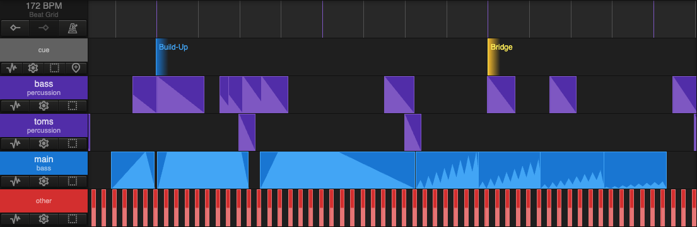

<h1 align="center">
  The Arcane Spell File Format
</h1>

<p align="center">
  
</p>

Arcane Spell Files are an open-source file-format that details precise timing
information of musical tracks,
for usage in lighting & visual applications for live events,
video rendering, pyrotechnics, etc...

They are the primary file format of the
[Arcane Desktop](https://arcanewizards.com/arcane) application,
and allow for quick exchange and sharing of timing information,
without the need to share full showfiles.

## Why?

Spell files are a core part of Arcane's alternative approach to timecode programming.

Instead of preparing a timeline of **what you want to happen**
for a specific track,
(e.g. what cues / macros / triggers to fire,
when to modulate the values of faders etc...),
you prepare a timeline of
**which audio elements in a track _might_ be cool to sync with visuals**.
This completely separates timeline preparation from Front-of-House showfiles,
which means a few different things:

- You can prepare spell files independently of the show itself,
  as you don't need to know what fixtures and other visual elements are
  available to use.

- Other people in production can prepare spell files
  (including DJs and audio producers),
  as all you need is the audio track itself.

- Spell files for the same tracks can be reused across different shows.

- During the live show, you can combine busking with the timing information from
  the Spell files, (e.g. using the
  [Arcane Desktop Spell Casting interface](https://arcanewizards.com/docs/arcane/getting-started/casting))
  to choose what outputs to link to what elements of the spell.
  You get the precision of timecoding,
  with the flexibility and creative freedom of busking.

## Spell Data

Spells are designed to be used across many different applications,
and contain enough data to easily identify which tracks they are applicable to.
As such, they contain the following data:

### Matchers

Matchers are information that applications can use to determine if a particular
track is something a given spell represents, and are akin to metadata.
Each spell can have multiple matchers,
but it's most common for only 1 to be defined.

Each matcher contains:

- A track length (in milliseconds)
- An offset in milliseconds (usually `0`)
- (optionally) An array of known track titles.
- (optionally) An array of known track artists.
- (optionally) An array of known track albums.

The offset can be used in cases where the same track can appear in multiple
compositions, or cuts, and is otherwise the same.

For example, you may have a sample of an original track,
that starts at 20 seconds into the original track and lasts for 30 seconds.
In this case, an additional matcher could have:

```ts
{
  lengthMillis: 30000,
  offsetMillis: 20000
}
```

This spell file could then be used for both the original track and the sample.

### Beat Grids

Spells usually have 1 beat grid, but can have `0` or more than 1.

Each beat grid defines:

- the timestamp of the first & last downbeats
- the beats per bar
- the total number of bars

This allows for flexibility for use with different time signatures.

For tracks with variable tempos,
you can expect multiple beat grids,
where the transition period has a number of sequential 1-bar beat grids

In [Arcane Desktop](https://arcanewizards.com/arcane),
beat grids are also used within the Spell Editor to make spell creation easier,
offering features like aligning cues and envelopes to grids / sub-grids,
and allowing for easily repeating sections over beats or bars,
including variable ones.

### Layers

Layers contain the actual important timing data that make spell files useful.

Each layer can be given a name, and is either:

- A **CUE** layer - containing a collection of markers,
  where each marker has a timestamp, label and color.

- An **ENVELOPE** layer - where:

  - The layer has a **type**, e.g. percussion, melody, bass, vocals or other.
  - Each item has a start & end time,
    and an envelope that tracks how the amplitude / intensity of that item
    changes over time; allowing elements like the attack, decay, sustain, and
    release to be accurately represented,
    and then used when connecting to real visual outputs.

The idea with this approach is that envelope data can then be used to accurately
control fader values (or other visual elements),
with much more precision that you typically get with simple markers.

There is no limitation to how many layers of each type a spell can have,
it is entirely up to you.
For example you could have 10 different percussion layers,
and 2 vocal layers... or just a single percussion layer with some cue markers.

Here is a screenshot of a section of a spell with cue markers,
2 percussion layers, a bass layer and some other layer.
Note in particular how:

- The percussion layers all have linear envelopes that gradually go down to `0`
- The bass layers have envelopes with more complex shapes,
  allowing for much more intricate and interesting visuals.
- The other layer has envelopes that have constant values,
  allowing for example strong "flashing" effects when controlling a fader.



## Comparison with other formats / techniques

### Reaper CSV

The marker CSV format established by the [REAPER DAW](https://www.reaper.fm/),
contains a list of markers, where each marker contains:

- A start time
- A label
- A color

They can also include ranges, where an end time & duration are also provided.

This format is widely supported in many applications,
but has a number of key differences compared to Spell files:

- No metadata - These files don't contain any information that allows you to
  match the information with a track. It's up to the user to manage,
  import & export their CSV files themselves.
- Markers only, no envelopes - These files don't contain any information about
  amplitudes / intensity, and how that changes over time, meaning that it's not
  possible to model attack, decay, etc...
- No grouping / layers - you cannot group your markers into different layers
  easily. Some apps like [HeadsUp](https://hybridconstructs.com/headsup)
  use workarounds such as using the color as a way to determine how markers
  should be grouped.

That being said,
[Arcane Desktop supports exporting spells to Reaper CSV format](https://arcanewizards.com/docs/arcane/spell-exporting/reaper-csv), and allows you to select: which layers to export,
an offset, a start & end time to include,
how to label them, and what colors to use.

### Audio Analysis / FFT

A common approach to synchronized visuals is to use an audio input for the
playing audio, and perform a frequency-based analysis of the incoming audio,
isolating frequencies, and then connecting these amplitudes to visual elements.

This is a common approach,
but it has a couple of drawbacks that makes it impractical for
some live use-cases:

- **Processing & signal delay** - some show setups can have a non-trivial amount
  of delay between the audio inputs and the visuals actually changing on-stage.
  This means that even if the audio processing has zero latency,
  there may still be enough latency between the light console / visual software
  and the stage to make the visuals seem out-of-sync.

  For these cases, the only real solution is knowing ahead-of-time when the
  lights or visuals need to change (either with some form of timecode,
  or with busking).

- **Isolation of instruments / elements** -
  some instruments or audio elements overlap in the frequencies they use,
  meaning that it's not possible to cleanly determine when a specific instrument
  is audible.

Whether spell files or live audio-processing is right for you then really
depends on your own workflow and situation. You could perhaps use spell files
for a portion of a show that needs to really have precise visuals,
and then use audio analysis on some easier to isolate frequencies
(e.g. bass drums) for the remainder of a show.

### Live MIDI Output from Controllers / DAWs / Ableton / etc...

Sometimes it's possible to receive MIDI signals from performers that accurately
describe what the audio is doing
(for example if they are using a MIDI keyboard / synth or drum / performance pad).
For these live performances,
being able to connect these MIDI signals directly to your visuals is going to
give you great results, unless there is significant signal delay / latency.

For these situations, in general,
Spell files will not provide much of an advantage over using the MIDI signals
directly.
However if there are also backing tracks being used in addition to the elements
that are providing MIDI output,
then spell files can still be used to describe the audio of the backing tracks.
You can then get the best of both worlds,
and have precise visuals for both the live and pre-mastered elements.

## Usage

## Supported Applications

- [Arcane Desktop](https://arcanewizards.com/arcane)

## License

MIT License

Copyright (c) 2026 Arcane Wizards Ltd

Permission is hereby granted, free of charge, to any person obtaining a copy
of this software and associated documentation files (the "Software"), to deal
in the Software without restriction, including without limitation the rights
to use, copy, modify, merge, publish, distribute, sublicense, and/or sell
copies of the Software, and to permit persons to whom the Software is
furnished to do so, subject to the following conditions:

The above copyright notice and this permission notice shall be included in all
copies or substantial portions of the Software.

THE SOFTWARE IS PROVIDED "AS IS", WITHOUT WARRANTY OF ANY KIND, EXPRESS OR
IMPLIED, INCLUDING BUT NOT LIMITED TO THE WARRANTIES OF MERCHANTABILITY,
FITNESS FOR A PARTICULAR PURPOSE AND NONINFRINGEMENT. IN NO EVENT SHALL THE
AUTHORS OR COPYRIGHT HOLDERS BE LIABLE FOR ANY CLAIM, DAMAGES OR OTHER
LIABILITY, WHETHER IN AN ACTION OF CONTRACT, TORT OR OTHERWISE, ARISING FROM,
OUT OF OR IN CONNECTION WITH THE SOFTWARE OR THE USE OR OTHER DEALINGS IN THE
SOFTWARE.

<p align="center">
  <a href="https://madebyhuman.iamjarl.com/">
    
  </a>
</p>
